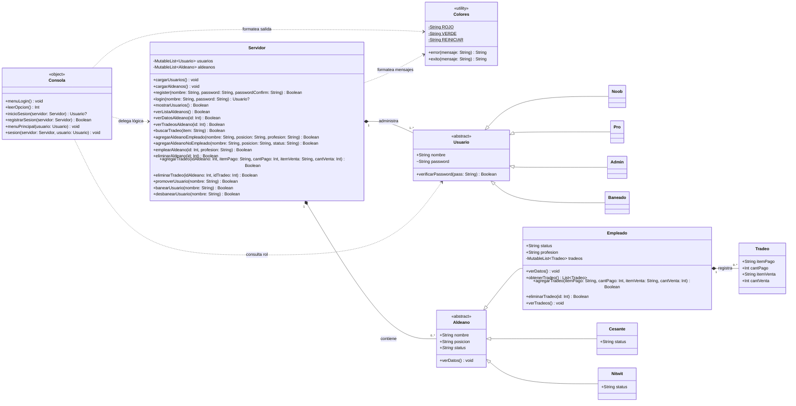

# Minecraft Villager Management

Sistema de consola para registrar, consultar y administrar los aldeanos de un *Trading Hall*
en Minecraft, junto con los intercambios que ofrece cada aldeano y los usuarios que pueden
operar sobre el registro.

## Tabla de contenidos

- [Descripción del problema](#descripción-del-problema)
- [Alcance y límites de esta versión](#alcance-y-límites-de-esta-versión)
- [Requisitos](#requisitos)
- [Estructura del proyecto](#estructura-del-proyecto)
- [Usuarios del sistema](#usuarios-del-sistema)
- [Entidades principales](#entidades-principales)
- [Operaciones que permite el sistema](#operaciones-que-permite-el-sistema)
- [Validaciones y reglas](#validaciones-y-reglas)
- [Formato de los archivos de datos](#formato-de-los-archivos-de-datos)
- [Compilación y ejecución](#compilación-y-ejecución)
- [Ejemplo de uso](#ejemplo-de-uso)
- [Diagrama UML](#diagrama-uml)
- [Autores](#autores)

## Descripción del problema

En los mundos multijugador técnicos o de supervivencia a largo plazo en Minecraft, es común agrupar
decenas de aldeanos en zonas conocidas como "Trading Halls" (salas de comercio).
Sin embargo, a medida que la zona crece, la cantidad de aldeanos se vuelve inmanejable.

Hoy en día, los jugadores intentan organizar esta zona usando carteles de madera o
simplemente confiando en su memoria. Esto genera varios problemas:

- **Pérdida de tiempo**: Los jugadores olvidan qué aldeano vende qué objeto exacto y pasan
    minutos buscando sin rumbo.
- **Posición**: No hay registro claro de en qué coordenadas exactas se
    encuentra el aldeano que vende un encantamiento crucial (como Mending/Reparación).
- **Falta de administración**: Cualquier jugador nuevo puede entrar, alterar los intercambios
    o perder aldeanos sin que haya un registro de quién hizo qué.

**Minecraft Villager Management** reemplaza los carteles y la memoria por un sistema de
registro estructurado. El sistema permite buscar rápidamente qué aldeano vende el objeto
deseado, conocer sus coordenadas exactas y restringir quién puede añadir o eliminar aldeanos
de la base de datos.

## Alcance y límites de esta versión

**Alcance:**

- Sistema interactivo por consola, con menús que cambian según el rango del usuario.
- Datos almacenados temporalmente en memoria durante la ejecución, inicializados desde archivos
  de texto.
- Control de acceso mediante registro e inicio de sesión.
- Operaciones de consulta para todos los usuarios y operaciones de gestión para `Pro` y `Admin`.
- Fuera de alcance: modificaciones directas dentro del juego (no es un mod, es una
  herramienta externa de gestión).

**Límites:**

- Sin registro permanente de datos: todo se almacena en memoria y se pierde al cerrar la
  aplicación. Los archivos de `data/` solo se leen al iniciar; no se sobrescriben.
- No se permiten múltiples instanciaciones de servidores (servidor único por ejecución).
- Administrador único establecido en el código fuente (`Notch` / `maincra`). No se puede crear
  otro `Admin`, ni promover a un usuario a `Admin`, ni cargar administradores desde archivos.
- Sin manejo de caracteres especiales (por ejemplo: `ñ` y acentuaciones del español).
- No se hace una carga inicial de tradeos: los aldeanos empleados se cargan sin intercambios y
  estos deben registrarse desde el menú.
- Imposibilidad de cambiar la posición del aldeano después de su creación. Para moverlo hay que
  eliminarlo y volver a registrarlo.
- Los identificadores (ID) de aldeanos y tradeos son posicionales: se calculan como
  `índice + 1` y se recalculan al eliminar un elemento.
- No existe edición de aldeanos ni de usuarios: solo se pueden eliminar, volver a crear o
  cambiar de rol según las operaciones disponibles.
- No se guarda un historial de acciones (auditoría) de quién agregó, eliminó o modificó cada
  registro.
- Las contraseñas se mantienen en texto plano en memoria y no se cifran.
- La búsqueda de tradeos es por coincidencia exacta del nombre del ítem y distingue mayúsculas
  de minúsculas.
- No se maneja el fin de la entrada estándar (EOF) de forma controlada; la ejecución con entrada
  redirigida debe terminar con la opción `Salir`.

## Requisitos

- **Java 8 o superior** para ejecutar el archivo `villager-management.jar` incluido
  (el JAR está compilado con bytecode de Java 8).
- **Kotlin 2.x** (probado con `kotlinc-jvm 2.4.21`) solo si se desea compilar desde el código
  fuente.
- Una terminal con soporte de colores ANSI (opcional; si no los soporta, los códigos de color
  pueden verse como texto).
- No se utilizan dependencias externas ni gestores de paquetes.

## Estructura del proyecto

El proyecto está contenido dentro de la carpeta principal `villager-management` y se organiza en
los siguientes directorios y archivos:

```text
villager-management/
├── main.kt                     # Punto de entrada de la aplicación
├── helpers/
│   ├── Consola.kt              # Menús, lectura por teclado y flujo de sesión
│   └── Colores.kt              # Formato de mensajes de error y éxito con colores ANSI
├── models/
│   ├── Servidor.kt             # Lógica central: usuarios, aldeanos y operaciones
│   ├── Aldeano.kt              # Aldeano y sus subtipos Empleado, Cesante y Nitwit
│   ├── Usuario.kt              # Usuario y sus subtipos Noob, Pro, Admin y Baneado
│   └── Tradeo.kt               # Intercambio de un aldeano empleado
├── data/
│   ├── aldeanos.txt            # Datos iniciales de aldeanos
│   ├── usuarios.txt            # Datos iniciales de usuarios
│   └── entrada.txt             # Secuencia de entradas para pruebas por redirección
├── villager-management.jar     # Aplicación compilada y lista para ejecutar
└── README.md
```

- **`/` (raíz):** contiene `main.kt`, que inicializa el `Servidor`, carga los datos y ejecuta el
  menú de inicio.
- **`/helpers`:** contiene la interfaz de usuario (`Consola.kt`) y la utilidad de colores
  (`Colores.kt`).
- **`/models`:** contiene la lógica de negocio y las entidades del sistema.
- **`/data`:** contiene los archivos de texto que se leen al iniciar. Los cambios realizados
  durante la ejecución **no** se escriben de vuelta en estos archivos.

## Usuarios del sistema

El sistema divide a los jugadores en cuatro tipos de usuario según su nivel de confianza y
experiencia en el servidor. El rol se representa mediante la clase del objeto (`Noob`, `Pro`,
`Admin` o `Baneado`):

| Usuario | Tarea desempeñada en el sistema |
| :---: | :--- |
| Baneado | No puede acceder al sistema. Se considera un usuario problemático. El baneo es reversible: un `Admin` puede desbanearlo y vuelve a ser `Noob`. |
| Noob | Tiene permisos de solo lectura. Su vista es superficial: busca objetos a la venta, consulta las coordenadas para saber a dónde ir y revisa los tradeos de un aldeano. |
| Pro | Tiene permisos de escritura. Además de consultar, puede registrar, eliminar y emplear aldeanos, así como agregar y eliminar sus tradeos. |
| Admin | Tiene los permisos de `Pro` y, además, puede listar usuarios, promover `Noob` a `Pro`, y banear o desbanear usuarios. |

**Cuenta administrador inicial:** el constructor de `Servidor` crea siempre al usuario
`Notch` con contraseña `maincra`. Es el único administrador y no puede ser baneado. Para cambiar
estas credenciales hay que modificar el código fuente (`models/Servidor.kt`).

**Cambios de rol:** se implementan reemplazando la instancia del usuario dentro de la lista del
servidor, conservando su nombre y contraseña:

- Registro de una cuenta nueva → `Noob`.
- `Promover Usuario` → `Noob` a `Pro`.
- `Banear Usuario` → cualquier usuario que no sea `Admin` pasa a `Baneado`.
- `Unban Usuario` → `Baneado` vuelve a `Noob` (no se recupera un rango `Pro` anterior).

## Entidades principales

Para que el sistema funcione y tenga sentido, se han definido los siguientes elementos:

### Servidor

Es el motor central del sistema. Actúa como el lugar virtual donde se guardan todos los
registros de los aldeanos y donde se conectan los usuarios. El servidor es quien recibe las
órdenes y actúa en consecuencia.

Mantiene dos listas privadas en memoria:

- `usuarios: MutableList<Usuario>`, inicializada con el administrador `Notch`.
- `aldeanos: MutableList<Aldeano>`, inicializada desde `data/aldeanos.txt`.

También concentra las validaciones de negocio, la carga de archivos y las operaciones de
consulta, gestión y administración.

### Usuario

Representa a la persona real frente a la pantalla. Todo usuario debe registrarse con un nombre
(nickname) y su respectiva contraseña. Dependiendo de su rango (`Noob`, `Pro` o `Admin`), el
sistema le permitirá realizar distintas acciones. Puede perder acceso al sistema (de manera
temporal) y volverse un usuario `Baneado`.

- `nombre` es público y no puede estar vacío.
- `password` es `internal` y se compara mediante `verificarPassword(pass)`.
- Todos los constructores requieren una contraseña explícita; no se asignan contraseñas
  predeterminadas.
- Las clases `Noob`, `Pro`, `Admin` y `Baneado` no agregan atributos ni métodos: el rol se
  determina por el tipo de objeto.

### Aldeano

Representa a cada aldeano dentro del juego. Cada uno de ellos recibe nombre y posición
(típicamente coordenadas). No se almacena un ID: el identificador que muestra el sistema se
calcula como la posición del aldeano en la lista del servidor (`índice + 1`). Por eso, al
eliminar un aldeano, los IDs de los siguientes se desplazan.

`Aldeano` es una clase abstracta con:

- `nombre` y `posicion`, ambos obligatorios y no vacíos.
- `status` abstracto, implementado por cada subtipo.
- `verDatos()`, que muestra nombre, estado y posición (los subtipos pueden ampliarlo).

Subtipos:

| Clase | `status` | Descripción |
| :---: | :---: | :--- |
| `Empleado` | `Empleado` | Tiene una profesión y una lista propia de tradeos. |
| `Cesante` | `Cesante` | No tiene empleo, pero puede ser empleado con la operación `Emplear Aldeano`. |
| `Nitwit` | `Nitwit` | No tiene empleo y no puede adquirir uno. |

La profesión de un `Empleado` se solicita al crearlo o al emplear un `Cesante` y no puede estar
vacía.

### Tradeo

Representa los datos presentes en un intercambio realizado por un aldeano `Empleado`.
Contempla los ítems en venta y a pagar, con sus respectivas cantidades:

- `itemPago`: artículo que recibe el aldeano.
- `cantPago`: cantidad del artículo de pago (mayor que cero).
- `itemVenta`: artículo que ofrece el aldeano.
- `cantVenta`: cantidad del artículo en venta (mayor que cero).

Los tradeos pertenecen a un `Empleado` y también usan IDs posicionales (`índice + 1`).

### Relaciones entre entidades

- **`Servidor` ◆— `Aldeano` (composición, 1 a 0..\*):** el servidor es dueño de la lista de
  aldeanos. Si el servidor desaparece, los registros también. El ID de cada aldeano depende de su
  posición en esa lista.
- **`Servidor` ◆— `Usuario` (composición, 1 a 1..\*):** el servidor administra la lista de
  usuarios y siempre contiene al menos al administrador inicial. Los cambios de rol se aplican
  reemplazando el objeto dentro de esta lista.
- **`Empleado` ◆— `Tradeo` (composición, 1 a 0..\*):** cada empleado mantiene su propia lista
  privada de tradeos; un tradeo no existe fuera del empleado que lo registra.
- **`Aldeano` ◁— `Empleado`, `Cesante`, `Nitwit` (herencia):** los tres subtipos comparten
  nombre, posición y la operación `verDatos()`, pero difieren en su estado y capacidades.
- **`Usuario` ◁— `Noob`, `Pro`, `Admin`, `Baneado` (herencia):** todos comparten credenciales,
  pero el tipo determina los permisos disponibles en el menú.
- **`Consola` ⇢ `Servidor` (dependencia):** la consola no implementa reglas de negocio; captura
  los datos y delega las operaciones al servidor.
- **`Consola` ⇢ `Usuario` (dependencia):** la consola consulta el tipo de usuario autenticado
  para construir el menú con las opciones permitidas.
- **`Consola` y `Servidor` ⇢ `Colores` (dependencia):** ambos usan la utilidad `Colores` para
  formatear los mensajes de éxito y error.

**Transiciones de estado relevantes:**

- Un `Cesante` se convierte en `Empleado` mediante `emplearAldeano`, que reemplaza el objeto en
  la misma posición de la lista y conserva nombre y posición.
- Un `Nitwit` nunca puede convertirse en `Empleado`.
- Un usuario `Noob` puede convertirse en `Pro`; un `Pro` no puede ascender a `Admin`.
- Un usuario no administrador puede convertirse en `Baneado` y luego volver a `Noob`.
- Un `Admin` no puede ser baneado.

## Operaciones que permite el sistema

El programa funciona a través de un menú interactivo centralizado. Las opciones visibles y su
numeración dependen del rango del usuario autenticado: el menú omite las opciones no permitidas y
`Cerrar Sesión` siempre ocupa el último número.

### Menú de inicio (fuera de sesión)

| Opción | Acción |
| :---: | :--- |
| 1 | **Iniciar Sesión:** accede al sistema con un nombre y contraseña válidos. |
| 2 | **Registrarse:** crea una cuenta nueva con rango `Noob`. |
| 3 | **Salir:** cierra la aplicación. |

### Menú de sesión

| Opción | Noob | Pro | Admin | Acción |
| :--- | :---: | :---: | :---: | :--- |
| Lista Aldeanos | ✓ | ✓ | ✓ | Muestra el ID, nombre y estado de todos los aldeanos. |
| Ver datos Aldeano | ✓ | ✓ | ✓ | Solicita un ID y muestra nombre, estado, posición y, si es empleado, su profesión. |
| Buscar Tradeo | ✓ | ✓ | ✓ | Solicita el nombre exacto de un ítem en venta y lista los empleados que lo venden, su ID y las cantidades del intercambio. No muestra la posición; para eso debe usarse `Ver datos Aldeano`. |
| Tradeos de Aldeano | ✓ | ✓ | ✓ | Solicita el ID de un aldeano empleado y lista sus tradeos con sus IDs posicionales. |
| Agregar Aldeano | — | ✓ | ✓ | Solicita nombre, posición y estado. Si el estado es exactamente `Empleado`, pide la profesión; `Cesante` y `Nitwit` también deben escribirse exactamente como se indican. |
| Eliminar Aldeano | — | ✓ | ✓ | Elimina el aldeano indicado por su ID. Los IDs siguientes se recalculan. |
| Emplear Aldeano | — | ✓ | ✓ | Solicita el ID de un aldeano `Cesante` y una profesión, y lo convierte en `Empleado`. |
| Agregar Tradeos | — | ✓ | ✓ | Solicita ID del empleado, ítem en venta y su cantidad, ítem de pago y su cantidad, y registra el intercambio. |
| Eliminar Tradeos | — | ✓ | ✓ | Solicita el ID del empleado y el ID del tradeo, y elimina el intercambio. |
| Lista Usuarios | — | — | ✓ | Muestra el nombre y el tipo de todos los usuarios registrados (sin contraseñas). |
| Promover Usuario | — | — | ✓ | Convierte a un usuario `Noob` en `Pro`. |
| Unban Usuario | — | — | ✓ | Convierte a un usuario `Baneado` en `Noob`. |
| Banear Usuario | — | — | ✓ | Convierte a un usuario no administrador en `Baneado`. |
| Cerrar Sesión | ✓ | ✓ | ✓ | Vuelve al menú de inicio. |

**Numeración resultante:**

- `Noob`: opciones 1–4 y `Cerrar Sesión` en 5.
- `Pro`: opciones 1–9 y `Cerrar Sesión` en 10.
- `Admin`: opciones 1–13 y `Cerrar Sesión` en 14.

## Validaciones y reglas

Para evitar que el sistema falle o tenga datos irreales, el sistema asegura que:

**Gestión de cuentas y accesos:**

- El nombre de usuario no puede estar vacío.
- Al registrarse, las contraseñas ingresadas deben coincidir de manera exacta.
- No se puede registrar un usuario con un nickname que ya esté en uso en el servidor.
- Un usuario en estado `Baneado` no puede iniciar sesión bajo ninguna circunstancia.
- Los usuarios con rango `Admin` son inmunes y no pueden ser baneados por otros administradores.
- Un usuario ya baneado no puede volver a ser baneado.
- Solo se puede promover a `Pro` a un usuario que sea `Noob`.
- Solo se puede desbanear a un usuario que esté `Baneado`; al hacerlo vuelve a `Noob`.
- Al cargar `data/usuarios.txt`, se omiten las líneas mal formadas, los nombres o contraseñas
  vacíos, los nicknames duplicados y los usuarios de tipo `Admin`.
- No se valida que la contraseña tenga una longitud o complejidad mínima.

**Gestión de aldeanos:**

- El nombre y la posición (coordenadas) de un aldeano no pueden ser campos vacíos.
- La profesión de un `Empleado` es obligatoria y no puede estar vacía.
- Solo se permite el ingreso de tres estados válidos para los aldeanos: `Empleado`, `Cesante` y
  `Nitwit`.
- En el menú, los estados deben escribirse exactamente como se indican, incluida la mayúscula
  inicial de `Empleado`.
- Únicamente los aldeanos en estado `Cesante` pueden ser modificados mediante la operación
  `Emplear Aldeano`. Los `Nitwit` son incapaces de adquirir empleo.
- La posición no se puede modificar después de crear el aldeano.
- Los IDs son posicionales y cambian cuando se elimina un aldeano anterior.

**Gestión de intercambios (tradeos):**

- Los intercambios solo pueden ser asignados a aldeanos en estado `Empleado`.
- El nombre del ítem entregado como pago y el nombre del ítem ofrecido en venta no pueden estar
  vacíos.
- Las cantidades de los ítems (tanto para pago como para venta) deben ser estrictamente mayores
  que cero.
- Los IDs de los tradeos son posicionales dentro de cada empleado y se recalculan al eliminar.
- La búsqueda de tradeos compara el nombre del ítem en venta de forma exacta y sensible a
  mayúsculas.

**Entrada de datos:**

- Si se ingresa una opción no numérica, nula o menor o igual a cero, se interpreta como `0` y se
  muestra un mensaje de opción inválida.
- Si un archivo de datos no existe o no se puede leer, se informa el error y el programa continúa
  con los datos que haya podido cargar.
- Las líneas de los archivos con menos campos de los requeridos, o con tipos desconocidos, se
  omiten con un mensaje de error.

## Formato de los archivos de datos

Los archivos se leen al iniciar la aplicación, desde la raíz del proyecto, y no se modifican
durante la ejecución. Cada línea representa un registro y los campos se separan por comas.

### `data/aldeanos.txt`

Formato:

```text
tipo,nombre,posicion,profesion
```

- `tipo`: `Empleado`, `Cesante` o `Nitwit`.
- `nombre`: nombre o apodo del aldeano (obligatorio).
- `posicion`: coordenadas o ubicación (obligatorio).
- `profesion`: solo se usa para `Empleado`; si se omite, se asigna `Librero`. Si se proporciona
  vacía, se rechaza el aldeano con un mensaje de validación.

Ejemplo incluido en el proyecto:

```text
Empleado,Guillermo,x=120 y=64 z=-30,Librero
Empleado,Kim,x=118 y=64 z=-30,Herrero de armas
Cesante,Miguelito,x=125 y=64 z=-28
Nitwit,Fulano,x=130 y=64 z=-25
```

Reglas de carga:

- Las líneas con menos de tres campos se omiten.
- Los tipos desconocidos se omiten.
- Los aldeanos se agregan al final de la lista, por lo que su ID depende del orden de carga.
- Los empleados cargados comienzan sin tradeos.

### `data/usuarios.txt`

Formato:

```text
tipo,nombre,password
```

- `tipo`: `Noob`, `Pro` o `Baneado`. No se permite `Admin`.
- `nombre`: nickname del usuario (obligatorio y no repetido).
- `password`: contraseña en texto plano (obligatoria en el archivo).

Ejemplo incluido en el proyecto:

```text
Pro,Vegetta777,guapisimo
Noob,JohnFortnite,epic
Baneado,Corxea,junglaLOL
```

Reglas de carga:

- Las líneas con menos de tres campos se omiten.
- Los nombres o contraseñas vacíos se omiten.
- Los nicknames duplicados se omiten (se conserva el primero cargado).
- Los usuarios de tipo `Admin` se rechazan; el único administrador es el creado en el código.

### `data/entrada.txt`

Contiene una secuencia de respuestas de teclado pensada para ejecutar el programa sin interacción
manual, por ejemplo:

```bash
java -jar villager-management.jar < data/entrada.txt
```

La secuencia debe respetar el orden de los menús y terminar con la opción `Salir`; de lo
contrario, el programa puede quedar esperando entrada o terminar de forma abrupta. Si se modifica
el menú, este archivo debe actualizarse.

## Compilación y ejecución

### Ejecutar el JAR incluido

Desde la raíz del proyecto (es importante, porque las rutas de `data/` son relativas):

```bash
java -jar villager-management.jar
```

En Windows:

```bat
java -jar .\villager-management.jar
```

### Compilar desde el código fuente

Se requiere tener `kotlinc` instalado y disponible en el `PATH`.

**Linux y macOS:**

```bash
kotlinc ./main.kt ./helpers/*.kt ./models/*.kt -include-runtime -d ./villager-management.jar
```

**Windows:**

```bat
kotlinc .\main.kt .\helpers\Consola.kt .\helpers\Colores.kt .\models\Aldeano.kt .\models\Servidor.kt .\models\Tradeo.kt .\models\Usuario.kt -include-runtime -d .\villager-management.jar
```

Luego se ejecuta con `java -jar villager-management.jar` desde la raíz del proyecto.

## Ejemplo de uso

Inicio de sesión como administrador y registro de un tradeo para el aldeano `Guillermo` (ID 1):

```text
1. Iniciar Sesión
Ingrese usuario: Notch
Ingrese contraseña: maincra

Menú principal (Admin):
8. Agregar Tradeos
ID del empleado: 1
Item que vende el aldeano: Libro
Cantidad del item en venta: 1
Item a pagar al aldeano: Esmeralda
Cantidad de pago: 1

3. Buscar Tradeo
Ingrese el item a buscar: Libro

ALDEANOS ENCONTRADOS
Guillermo (ID: 1)
    Vende: 1 Libro
    Precio: 1 Esmeralda
```

Para consultar la ubicación de `Guillermo`, se usa la opción `2. Ver datos Aldeano` con el ID `1`.
Al terminar, `14. Cerrar Sesión` vuelve al menú de inicio y `3. Salir` cierra la aplicación.

## Diagrama UML

A continuación se detalla la estructura lógica del sistema, reflejando la separación entre la
interfaz de consola, el motor lógico y los modelos de datos. El diagrama representa las clases
reales del código: `Consola` y `Colores` son objetos únicos de Kotlin (`object`), y el rol de un
usuario se modela mediante herencia porque el código utiliza subtipos de `Usuario`.


## Autores

Proyecto desarrollado por:

- Benjamín Muñoz Balboa
- Carlos Rojas Valdés
- Carlos Moreno Rojas
- Manuel Astudillo Ayala
